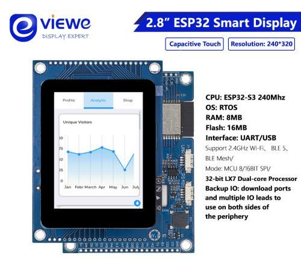

# smarthome-hmi — SmartHome touch display (Viewe 2.8" 240x320)

Firmware (PlatformIO + LVGL) that turns the Viewe ESP32-S3 2.8" touch board into a wall display for one SmartHome gateway. It joins Wi-Fi, pairs with the hub using a code/QR, shows the nodes assigned to it and controls them. Theme, background, accent, brightness and the onboard RGB LED are changed from the app or web UI.

## Installation & first-time setup

Set up the hub first (`../smarthome-hub/README.md`) and note its LAN IP.

### 1. Prerequisites

- [PlatformIO](https://platformio.org/) CLI or VS Code extension. Board/platform (`espressif32@6.9.0`) and libraries (LVGL 9.4, GFX Library, SensorLib, WS2812FX, ArduinoJson, NimBLE) download on the first build, which takes several minutes.
- USB-C cable to the board's native USB port (appears as `/dev/ttyACM*`); Linux: `sudo usermod -aG dialout $USER`.

### 2. ⚠️ Set the hub address (required)

Either edit `include/config.hpp`, or add build flags to `platformio.ini`:

```ini
build_flags =
    -D LV_USE_OBJ_NAME=1
    -D LV_CONF_INCLUDE_SIMPLE
    -I include
    -D HMI_HUB_HOST=\"192.168.1.50\"   ; <-- YOUR hub's IP address
    ; -D HMI_HUB_PORT=9000             ; only if you changed SERVER_PORT
```

Also update the fallback `m_hubHost` in `include/network_manager.hpp` to the same IP. The shipped `192.168.100.100` is the author's network. `HMI_WIFI_SSID`/`HMI_WIFI_PASSWORD` in `config.hpp` are placeholders and are **not** used: Wi-Fi is entered on the device (below).

### 3. Build & flash

```bash
pio run
pio run -t upload --upload-port /dev/ttyACM0
pio device monitor -b 115200      # serial log (the board's UART0 logs also appear on pins IO43/IO44)
```

Re-flashing does **not** erase saved Wi-Fi or pairing (they live in NVS/Wi-Fi storage). To wipe the board fully: `pio run -t erase`.

### 4. Join Wi-Fi and pair

1. First boot shows the boot animation, then, with no saved Wi-Fi, the **Wi-Fi setup** screen. Use the app (Menu → **Set up HMI Wi-Fi**) or connect a phone to the access point **`SmartHome-HMI-XXXX`** and open `http://192.168.4.1` to enter your **2.4 GHz** Wi-Fi.
2. Once online it asks the hub for a pairing code and shows a **6-digit code and QR**.
3. In the app (Menu → **Pair a display**, scan the QR) or the web UI (Displays → type the code) claim it and choose its gateway; then pick which nodes it shows. A node can be on only one display.
4. Appearance (theme, background colour, accent, brightness, RGB LED pattern) is changed under the display's **Appearance** page; the display applies it within about 5 seconds.
5. Power saving: on the display open **Settings -> Display** (or the display's Appearance page in the app/website) to set the screen brightness, how long without a touch before the screen goes dark (Never ... 30 min), the RGB LED brightness, and whether the RGB LED switches off with the screen. The first touch only wakes the screen. Changes made on the display are saved on the hub, so the app and website show the same values.

Removing the display from **Displays** in the app/web UI unpairs it at once; it then asks for a new code.

## Troubleshooting

- *Stuck on the Wi-Fi screen*: the SSID must be 2.4 GHz and in range; the display scans first, then connects (up to ~30 s).
- *Cannot reach the hub*: check the IP above, that the hub is running and its firewall allows port 9000.
- *Serial log*: look for `[NET]`, `[DM]`, `[UI]` lines.

---

# Viewe 2.8" 240x320 Board

## Overview

The UEDX24320028E-WB is a 2.8-inch 240×320 capacitive-touch smart display powered by the ESP32-S3. It features built-in Wi-Fi & BLE 5, high-capacity Flash/PSRAM, and an optimized UART protocol, making it a powerful solution for rapid HMI and IoT development.

<p align="center" width="80%">
    
</p>

## Links

Here you can find additional relevant information such as datasheets and schematics.

- [`Official Viewe Repo`](https://github.com/VIEWESMART/UEDX24320028ESP32-2.8inch-Touch-Display)
- [`Product Link`](https://viewedisplay.com/product/esp32-2-8-inch-240x320-mcu-ips-tft-display-touch-screen-arduino-lvgl-wifi-ble-uart-smart-module/)

## Hardware Features

- ESP32-S3-N16R8, i n16 MB Flash + 8 MB PSRAM (520 KB SRAM / 448 KB ROM)
- Type C USB programming port
- 2.8" TFT Touch 240×320 resolution
- MicroSD card slot
- WS2812B LED
- Buzzer
- RS485 & UART header


## Pin Overview

| IPS Screen Pin  | ESP32S3 Pin|
| :------------------: | :------------------:|
| CS         | IO42       |
| SCK         | IO40       |
| MOSI         | IO45       |
| DC         | IO41       |
| RST         | IO39       |
| BACKLIGHT   | IO13       |

| Touch Chip Pin  | ESP32S3 Pin|
| :------------------: | :------------------:|
| RST         | IO2(Not Used)|
| INT         | IO4(Not Used)|
| SDA         | IO1       |
| SCL         | IO3       |

| USB (CH340C) Pin  | ESP32S3 Pin|
| :------------------: | :------------------:|
| D+(USB-DP)    | IO20       |
| D-(USB-DN)    | IO19       |

| button Pin  | ESP32S3 Pin|
| :------------------: | :------------------:|
|   boot    | IO0       |
|   reset   | chip-en   |

| SD Card Pin  | ESP32S3 Pin|
| :------------------: | :------------------:|
| D1         | IO18       |
| D2         | IO15       |
| MOSI        | IO17       |
| MISO         | IO16       |

| UART/RS485 Pin  | ESP32S3 Pin|
| :------------------: | :------------------:|
| UARTTX         | IO43(RXD0)      |
| UARTRX         | IO44(TXD0)      |

| RGB LED Pin  | ESP32S3 Pin|
| :------------------: | :------------------:|
| RGB LED         | IO0   |

| Buzzer Pin  | ESP32S3 Pin|
| :------------------: | :------------------:|
|   buzzer    | IO38  |
